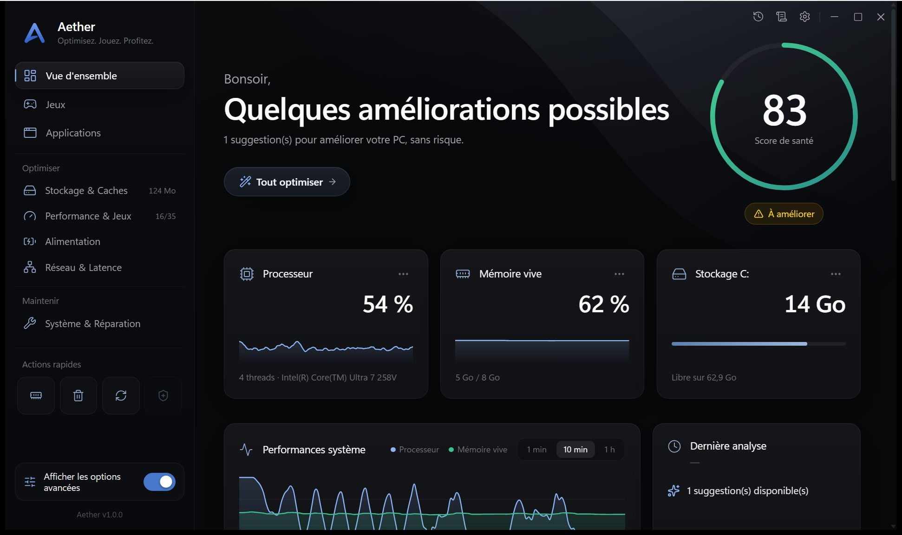
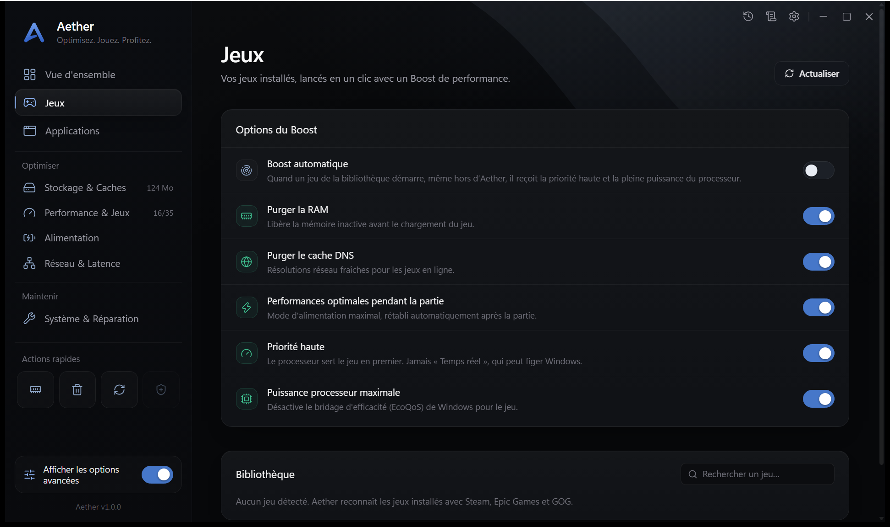
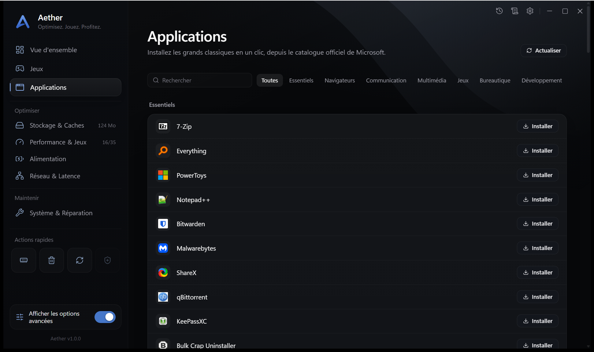
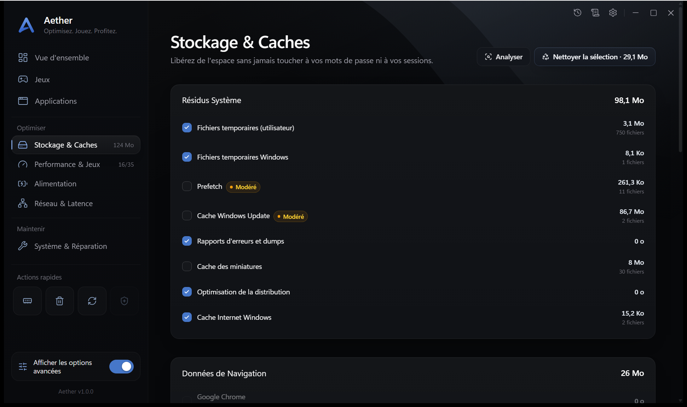

<p align="center"></p>

<h1 align="center">Aether</h1>

<p align="center">
  <strong>Optimisez. Jouez. Profitez.</strong><br>
  Optimiseur et outil de maintenance pour Windows 10 et 11 : idempotent, réversible et transparent.<br>
  Rust + Tauri v2 · React · open source (MIT).
</p>

<p align="center">
  <a href="https://github.com/sxchxa/aether/releases/latest"></a>
  <a href="https://github.com/sxchxa/aether/actions/workflows/ci.yml"></a>
  <a href="LICENSE"></a>
  
</p>

<p align="center"><a href="https://github.com/sxchxa/aether/releases/latest"><strong>⬇ Télécharger Aether pour Windows</strong></a></p>

<p align="center"></p>

---

## Pourquoi Aether ?

- **Adapté à chacun.** Au premier lancement, choisissez votre niveau : Débutant (réglages sans danger uniquement), Joueur ou Expérimenté.

- **Rien à l'aveugle.** Chaque réglage lit d'abord l'état réel de Windows. Un réglage déjà fait est affiché comme tel et n'est jamais retouché.
- **Tout est réversible.** Un point de restauration est créé automatiquement et la page « Points de restauration » permet de revenir à l'un d'eux. L'état d'origine est sauvegardé à la première modification. L'historique permet d'annuler en un clic, et un point de restauration peut être créé automatiquement avant chaque optimisation groupée.
- **Uniquement des réglages sûrs et documentés.** Paramètres officiels de Windows ou stratégies Microsoft. Les « astuces » de forum qui ne font rien ou qui abîment Windows sont écartées (voir plus bas).
- **Transparent.** Le bouton `?` de chaque réglage explique son rôle, le gain attendu, les précautions, et la clé de Registre ou la commande exacte.
- **Testé sur un vrai Windows.** Chaque option est appliquée, revérifiée puis restaurée à l'identique par des tests de bout en bout.

## Fonctions

| Section | Ce qu'elle fait |
|---|---|
| **Vue d'ensemble** | Score de santé · suggestions sûres en un clic · processeur, mémoire et stockage en direct · historique des performances (10 min / 30 min / 1 h, moyennes sur 10 s) · mesures **Avant / Après** (démarrage de Windows, mémoire, processus, services, programmes au démarrage) · **9 profils** rangés par usage (Quotidien, Jeu, Travail et **Client** pour les interventions chez un client) · **rapport PDF** (modifications, mesures, gains possibles) |
| **Jeux** | Détection des jeux Steam, Epic Games et GOG · lancement avec **Boost** (purge RAM, DNS, mode d'alimentation maximal rétabli après la partie, priorité haute, pleine puissance processeur) · réglages Boost **par jeu** · **Boost automatique** des jeux lancés hors d'Aether |
| **Applications** | 69 grands classiques installés ou mis à jour en un clic via **winget** (catalogue officiel de Microsoft), avec leurs logos officiels |
| **Stockage & Caches** | Fichiers temporaires, caches des navigateurs (mots de passe, cookies et sessions jamais touchés), caches de jeux et de pilotes graphiques · analyseur de gros fichiers · **fichiers en double** · **santé des disques (SMART)** · **entretien automatique hebdomadaire** |
| **Performance & Jeux** | Services en arrière-plan · réglages de jeu (Mode Jeu, jeux en fenêtre, planification GPU…) · interface et démarrage (dont le **mode sombre de Windows**) · **effets visuels de Windows** (le lissage des polices n'est jamais modifié) · système de fichiers · purge RAM · TRIM SSD |
| **Alimentation** | Détection PC fixe / portable · « Performance maximale » en un clic · réglages avancés (protégés automatiquement sur les portables) · **état de la batterie** (usure, cycles, rapport complet) |
| **Réseau & Latence** | Carte réseau (veille, économie d'énergie) · **DNS chiffré**, LLMNR et SMBv1 · comparatif des serveurs DNS de référence (Cloudflare, Google, Quad9) · **test de débit** (latence, téléchargement, envoi) · purge DNS et réinitialisation Winsock |
| **Système & Réparation** | **Passage à Windows 11** depuis Windows 10 (Assistant officiel, ou image officielle pour les PC non pris en charge) · Windows Update (redémarrages, heures d'activité, pilotes, grosses mises à jour) · confidentialité · applications préinstallées · programmes au lancement avec leur **impact réel sur le démarrage** · menu clic droit classique · OneDrive · Edge · SFC et DISM |
| **Réglages** | Langue (fr, en, es, de, it) · **thème sombre, clair ou celui de Windows** · contraste renforcé et raccourcis clavier · lancement au démarrage de Windows · point de restauration automatique · **« Tout rétablir »** · import et export de configuration · communauté |

<p align="center">
  
  
</p>
<p align="center">
  
  
</p>

## Sécurité

- **Aucun composant n'est endommagé.** Aucune protection thermique n'est désactivée, le TRIM ne défragmente jamais un SSD, la priorité « Temps réel » n'est jamais utilisée et les services ne sont jamais désactivés (seulement passés en Manuel).
- **WebView2 n'est jamais touché.** Aether en dépend, comme beaucoup d'applications. Edge garde aussi ses mises à jour de sécurité.
- **Nettoyage prudent et rapide.** Fichiers temporaires et caches supprimés directement, en parallèle (comme le Nettoyage de disque de Windows) ; les fichiers personnels (analyseur, doublons) partent à la Corbeille. Les dossiers système sont refusés sur tous les lecteurs, après résolution du chemin réel (raccourcis, jonctions, `..`). Les fichiers et dossiers récents sont ignorés.
- **Gardes adaptées à chaque PC.**
  - Sur un portable, l'hibernation est conservée et les réglages « PC fixe » ne sont pas appliqués automatiquement.
  - Sur un PC d'entreprise, le DNS n'est pas modifié.
  - Si une copie de fichiers est en cours, l'Explorateur n'est pas redémarré.
  - Si votre Bureau ou vos Documents sont synchronisés dans OneDrive, sa désinstallation est refusée.
- **Session de jeu interrompue :** si Aether se ferme pendant une partie, le mode d'alimentation d'origine est rétabli au lancement suivant.

### Écartés volontairement

| Réglage | Raison |
|---|---|
| Réserve de bande passante QoS « 20 % » | N'existe pas pour l'usage normal : aucun effet |
| Désactivation d'IPv6 | Déconseillée par Microsoft, casse des fonctions de Windows |
| Algorithme de Nagle (`TcpAckFrequency`) | Les jeux modernes le contournent déjà |
| `Win32PrioritySeparation` | La valeur « optimisée » est déjà celle de Windows |
| Désactivation de l'intégrité de la mémoire (HVCI) | Réduit la sécurité, incompatible avec des anti-triche |
| Désactivation de Defender ou suppression de services | Dangereux |

### Sources

Chaque option correspond à un interrupteur des Paramètres Windows ou à une stratégie documentée par Microsoft, par exemple :

- [Options de `powercfg`](https://learn.microsoft.com/windows-hardware/design/device-experiences/powercfg-command-line-options) et [ADMX_Power](https://learn.microsoft.com/windows/client-management/mdm/policy-csp-admx-power)
- [Privacy Policy CSP](https://learn.microsoft.com/windows/client-management/mdm/policy-csp-privacy), [WindowsAI](https://learn.microsoft.com/windows/client-management/mdm/policy-csp-windowsai), [NewsAndInterests](https://learn.microsoft.com/windows/client-management/mdm/policy-csp-newsandinterests)
- [Delivery Optimization](https://learn.microsoft.com/windows/deployment/do/waas-delivery-optimization-reference) et [Windows Update for Business](https://learn.microsoft.com/windows/deployment/update/waas-configure-wufb)
- [DNS over HTTPS](https://learn.microsoft.com/windows-server/networking/dns/doh-client-support), [SMBv1](https://learn.microsoft.com/windows-server/storage/file-server/troubleshoot/detect-enable-and-disable-smbv1-v2-v3)
- [Mode Jeu](https://support.xbox.com/help/games-apps/game-setup-and-play/use-game-mode-gaming-on-pc) et [optimisations des jeux en fenêtre](https://support.microsoft.com/windows/optimizations-for-windowed-games-in-windows-11)

## Installation

Téléchargez `Aether_x.y.z_x64-setup.exe` depuis la [dernière version](https://github.com/sxchxa/aether/releases/latest) puis lancez-le. Aether demande les droits administrateur, car il modifie des réglages système. WebView2 est installé automatiquement si nécessaire.

## Développement

Prérequis : Windows 10 ou 11, Node 24+, Rust stable (MSVC) et WebView2. Lancez votre terminal **en administrateur** : Aether et ses tests exigent l'élévation.

```powershell
npm install
npm run tauri dev          # application en mode développement
npm run typecheck          # TypeScript strict
npm run lint               # analyse statique (oxlint, règles des hooks React)
npm run format:check       # mise en forme (Prettier)
npm test                   # tests de l'interface (Vitest)
npm run check:i18n         # cohérence des 5 langues
cd src-tauri
cargo fmt --check          # mise en forme (rustfmt)
cargo clippy --all-targets -- -D warnings
cargo test                 # tests unitaires (bac à sable)
# Tests de bout en bout sur un vrai Windows (machine de test) : appliquer → vérifier → restaurer
cargo test --test e2e -- --ignored --nocapture --test-threads=1
```

### Architecture

```
src-tauri/src/
  core/        erreurs, commandes silencieuses, Registre, sauvegardes, historique, moteur idempotent (trait Tweak)
  modules/     overview · storage · performance · network · system · games · apps · autostart
src/
  components/  menu, fenêtre, panneau d'explication, palette Ctrl+K, journal
  features/    une page par section, accueil et réglages
  i18n/        dictionnaires typés (le français définit le type)
```

**Ajouter une option :** implémentez `Tweak` (ou déclarez un `RegistryTweak`), enregistrez-la dans `modules::catalog()`, puis ajoutez ses textes dans `src/i18n/locales/*.ts`. Elle hérite automatiquement de la lecture d'état, de l'idempotence, de la sauvegarde et de l'annulation.

Voir [CONTRIBUTING.md](CONTRIBUTING.md) pour les règles du projet.

## Publication

- `npm run tauri build` produit un installateur NSIS multilingue, installé pour tous les utilisateurs, avec WebView2 embarqué en mode silencieux.
- La CI `.github/workflows/ci.yml` vérifie chaque modification (mise en forme, analyse statique, types, traductions, tests, Clippy). `release.yml` compile et publie l'installateur sur un tag `v*`.
- Mises à jour automatiques :
  1. Définissez les secrets `TAURI_SIGNING_PRIVATE_KEY` et `TAURI_SIGNING_PRIVATE_KEY_PASSWORD`.
  2. Vérifiez `plugins.updater.pubkey` et l'URL `plugins.updater.endpoints` dans `src-tauri/tauri.conf.json`.

## English

Aether is a free, open-source Windows 10/11 optimizer written in Rust (Tauri v2) and React. Every setting reads the real system state first, is idempotent and reversible, and relies only on official Windows settings or documented Microsoft policies. The interface is available in English, French, Spanish, German and Italian. See the sections above for features, safety guarantees and build instructions.

## Licence

MIT, voir [LICENSE](LICENSE).

